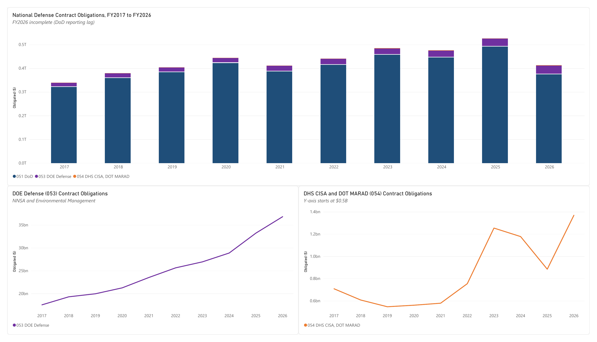
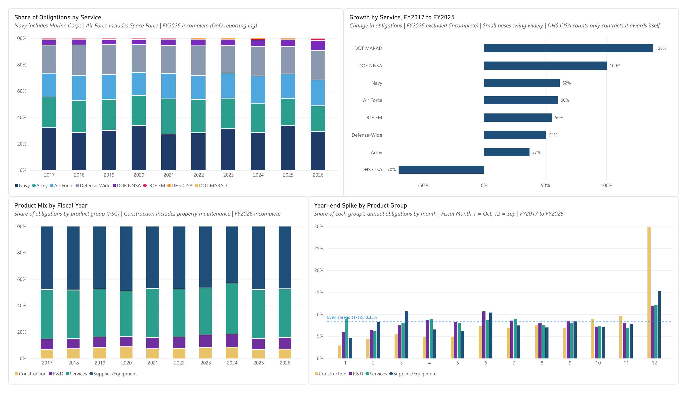
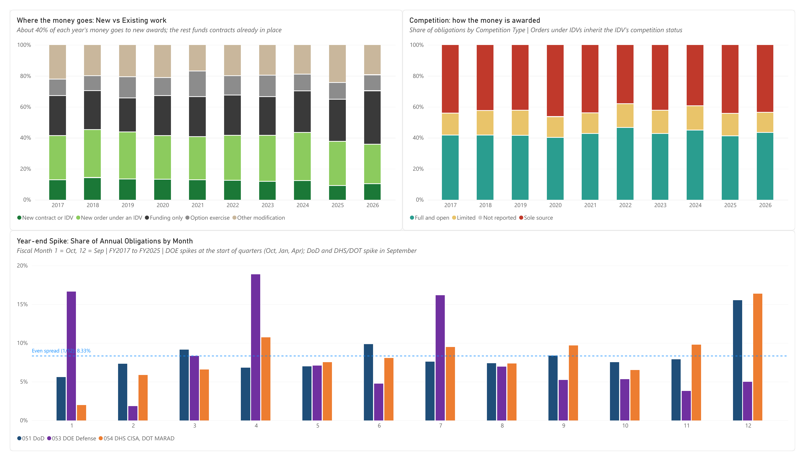
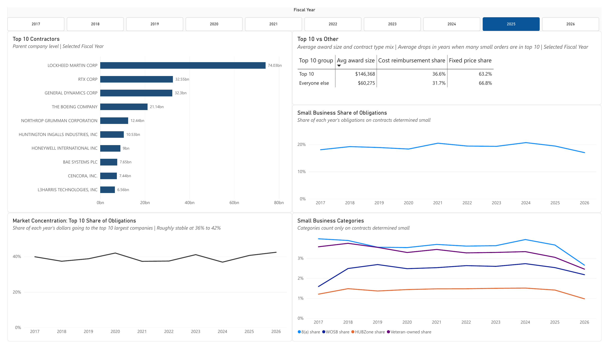
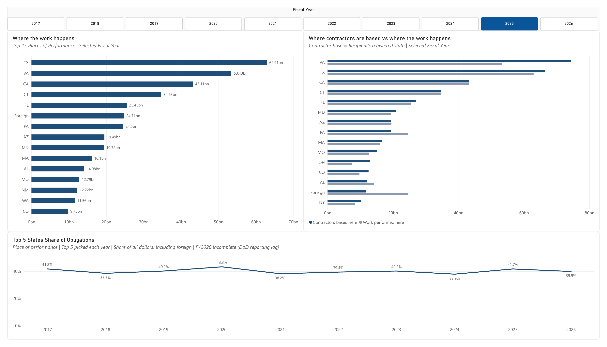
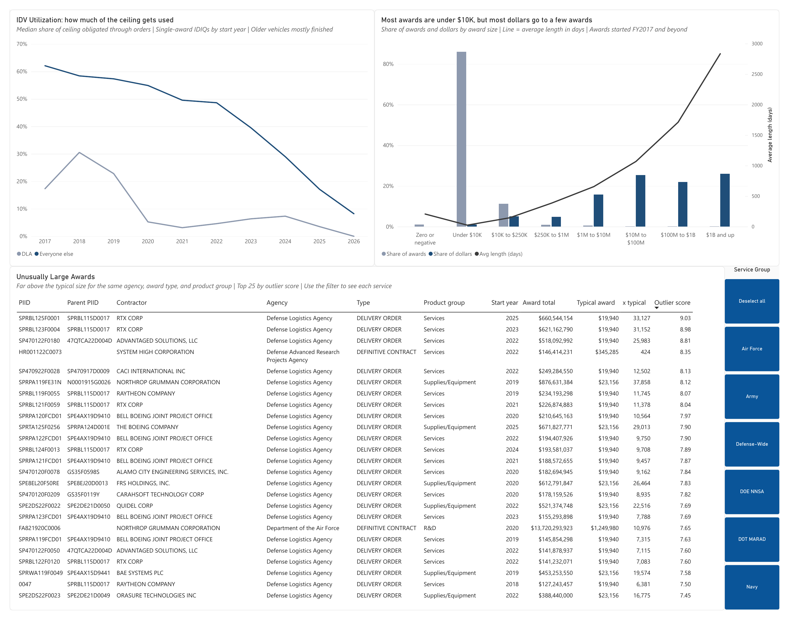
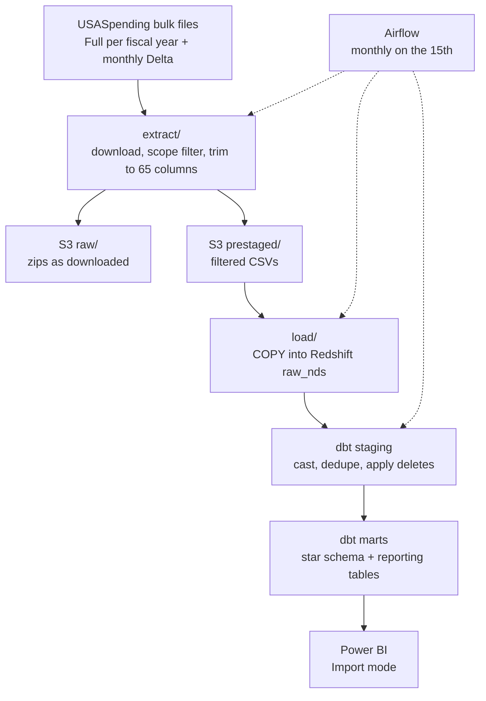
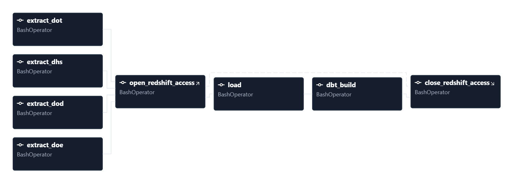
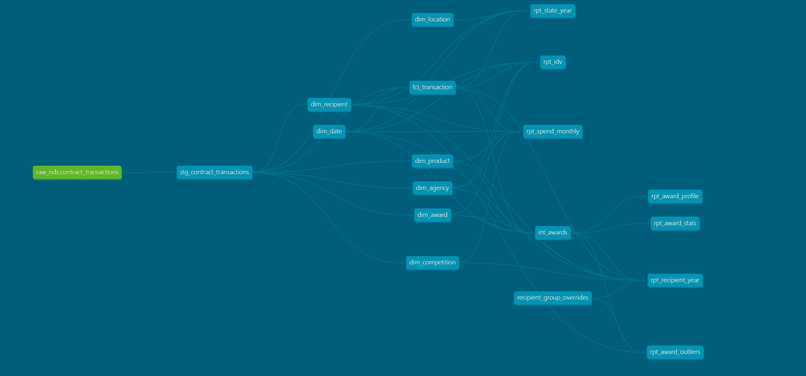

# national-defense-spending

An ELT pipeline and Power BI dashboard for U.S. national defense contract spending, FY2017 to present, built on USASpending.gov bulk files.

**Stack:** Python, AWS S3, Redshift Serverless, dbt, Airflow (Docker Compose), Power BI

Data is through USASpending's October 2026 publish: about 41.8 million contract transactions. FY2026 is incomplete because DoD reports with a 90-day lag.

## Key findings

- Contract obligations grew 55% from FY2017 to FY2025 ($340B to $526B), but only about 18% after inflation.
- DOE's defense work, mostly NNSA, roughly doubled ($17.5B to $33.2B). Navy is the largest service.
- The top 10 parent companies take 37% to 42% of each year's dollars, with no trend. Lockheed Martin received $74B in FY2025, more than twice the next company.
- Mergers didn't speed up growth: three of five merged companies (RTX, Northrop + Orbital ATK, L3Harris) lost market share after their deal.
- Sole source is 38% to 46% of each year's dollars, with no sustained growth.
- DoD puts about 15.5% of its annual dollars into September, nearly double an even month. Construction is the most end-loaded: 29.9% in September.
- 86% of awards are under $10K but carry under 1% of dollars. The 337 awards of $1B and up carry about 29%.

Every Phase 1 question in the [Data Plan](docs/dataplan.md) is answered in [findings.md](docs/findings.md), with caveats and the query or dashboard page behind each answer.

## Dashboard

`dashboard/national_defense_spending.pbix`, Import mode on the reporting tables.

**Overview:** obligations by subfunction, DOE and DHS/DOT trends


**Services and Products:** service share and growth, product mix, year-end spike by product group


**Spending Patterns:** new vs existing work, competition, year-end spike by subfunction


**Contractors:** top 10, market concentration, small business


**Geography:** place of performance, contractor base vs work location, top 5 states trend


**Awards:** IDV utilization, award size profile, outliers


## Architecture



**Airflow DAG** (`nds_monthly`): extracts run in parallel, then load and dbt between opening and closing Redshift access.


**dbt lineage:** source, staging, seven dimensions and the fact table, `int_awards`, the overrides seed, and the seven reporting tables.


[Whiteboard notes](docs/images/whiteboard.jpg) kept through the build: scope and agency hierarchy, extract design, S3 and Redshift state, the star schema, Airflow, and the dashboard layout.

## Scope

Federal contract and IDV award spending tied to OMB's National Defense budget function (050):

| Subfunction                           | Agency                            | In scope                                                                                  | Extraction                                        |
|---------------------------------------|-----------------------------------|-------------------------------------------------------------------------------------------|---------------------------------------------------|
| 051: Department of Defense-Military   | Department of Defense             | Entire department                                                                         | Bulk files (Full + Delta)                         |
| 053: Atomic energy defense activities | Department of Energy              | Defense offices only: NNSA, Environmental Management, Hanford, Office of River Protection | Bulk files, filtered by awarding office code      |
| 054: Defense-related activities       | Department of Transportation      | Maritime Administration sealift readiness programs                                        | Bulk files, filtered by funding federal account   |
| 054: Defense-related activities       | Department of Homeland Security   | CISA accounts                                                                             | Bulk files, filtered by funding federal account   |

### Scope note

This project tracks federal **award spending** (contracts and IDVs for v1, grants in a later phase), not the complete federal budget for National Defense. USASpending's award data only covers money paid to a non-federal recipient (a vendor, a grantee, a borrower). Intragovernmental transfers, such as DoD's payments into the Military Retirement Fund, never appear as award data. As a result, totals in this project will not reconcile to the full National Defense budget total, only to the award-based subset of it.

### A note on "National Defense"

"National Defense" here means OMB's budget function 050, an accounting classification assigned per federal account, not a plain description of "defense-related work." Classification happens at the account level, not the activity level, which is why a few otherwise defense-adjacent accounts are excluded from this project. They fund a mix of defense and non-defense work with no way to cleanly separate the two.

### Why extraction differs by agency

DoD and DOE are each nearly synonymous with their own subfunction (051 and 053), so pulling the whole agency's bulk file is already approximately in scope, DOE just adds a local office-code filter on top to drop its civilian science and energy work. DHS and DOT are not defense agencies. Their defense-tagged spending (CISA, Maritime Administration) is a small slice of a much larger non-defense budget, so each required a scoping step up front, a government-wide query of subfunction 054 to identify exactly which federal accounts carry the tag, before their bulk files could be filtered down to the relevant rows.

## Design decisions

- **ELT.** `extract/` only downloads, lands, and scope-filters. Renaming, casting, and cleanup happen in dbt.
- **Prestaging.** Bulk files have 297 columns. Redshift at 4 RPU caps tables at 100, and `COPY` can't read zips or skip CSV fields, so files are trimmed to the 65 columns the schema needs before load. The untouched zips stay in `raw/`.
- **Full files once, Deltas monthly.** USASpending regenerates every year's Full file monthly, so re-pulling would duplicate rows. Staging keeps the latest version of each transaction by `last_modified_date` and drops ones whose latest version is a delete.
- **Raw layer is all varchar.** Casting happens in staging, so a bad value fails a dbt test instead of a `COPY`. Each file loads into a temp table and is inserted with its S3 key, which makes reloads idempotent.
- **Star schema.** Seven dimensions and `fct_transaction`, with `dbt_utils` surrogate keys.
- **SCD2 recipients.** `dim_recipient` versions parent company and registered state by each recipient's dominant values per fiscal year. Change detection per transaction gave about 459,000 versions, because the source's parent field flips between entities of the same company.
- **Reporting tables in dbt.** Power BI imports seven `rpt_` tables (about 750K rows), not the fact table. Aggregation and statistics are in dbt, where they're tested.
- **Recipient group overrides.** USASpending splits large companies across several parent records. A seed merges them for every family that reached a yearly top 25, and `analyses/recipient_group_gaps.sql` finds new records after a data refresh.
- **Monthly full rebuild.** Deltas change and delete existing rows and `dim_recipient` needs full history, so dbt rebuilds everything monthly (about 8 minutes) instead of running incrementally.
- **Airflow on a laptop.** LocalExecutor in Docker Compose. The DAG adds the laptop's current IP to the Redshift security group before loading and removes it afterward, so runs work from any network.

## Environments

Dev is built; prod is designed but not deployed. See [environments.md](docs/environments.md).

## Repo layout

```
extract/        download, filter, and land bulk files in S3
load/           COPY prestaged files into Redshift; raw table DDL
transform/      dbt project (staging, marts, seeds, analyses)
orchestrate/    Airflow DAG, Dockerfile, docker-compose.yaml
dashboard/      Power BI file
docs/           data plan, schema design, findings, environments, screenshots
aws/            IAM policies and AWS setup notes
endpoint_mapping/  scripts used to work out the scope
```

## Running it

Requires Python 3.13, AWS CLI profiles `nds-extract-dev` and `nds-sg-access-dev`, a Redshift Serverless workgroup, and Docker Desktop for Airflow.

```bash
python -m venv venv
source venv/bin/activate          # Windows: venv\Scripts\activate
pip install -r requirements.txt -r requirements-dbt.txt
cp .env.example .env              # Redshift host, user, password, COPY role ARN

python -m load.generate_ddl       # writes load/ddl/raw_contract_transactions.sql; run it once in Redshift
python -m extract                 # all sources, or --source dod|doe|dhs|dot
python -m load

cd transform
dbt deps
dotenv -f ../.env run -- dbt build
```

Airflow, from `orchestrate/`, with an `.env` holding `AIRFLOW_UID`, `AWS_CONFIG_DIR`, `AIRFLOW_CONN_SMTP_DEFAULT`, and `ALERT_EMAIL`:

```bash
docker compose build
docker compose up airflow-init
docker compose up -d              # UI at localhost:8080
```

The `nds_monthly` DAG runs on the 15th, after USASpending's monthly publish.

## Known limitations

- A month the DAG never runs loses that month's Delta. Recovery is a full rebuild from fresh Full files.
- DHS and DOT rows with a blank funding account can't be attributed to 054 (up to about 5% of DHS dollars).
- Scope is by awarding agency, so contracts other agencies award on behalf of CISA aren't counted.
- DoD totals include some Corps of Engineers civil works funding (under 2% a year).

## Next steps

- Inflation-adjusted chart in Power BI (the CPI seed exists), and a goals seed for small business goal lines
- Read-only Redshift reporting user for Power BI
- Phase 2 Data Plan questions, including grants